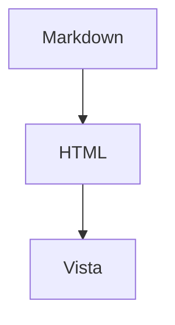

# MD Viewer

Un párrafo con **negrita**, *cursiva*, `código` y un [enlace](https://example.com).

## Tabla

| Columna | Valor |
|---------|------:|
| a       |     1 |
| b       |     2 |

## Tareas

- [x] Hecha
- [ ] Pendiente

## Código

```ts
const saludo: string = 'hola';
console.log(saludo);
```

## Matemáticas

La identidad $e^{i\pi} + 1 = 0$ y un bloque:

$$
\int_0^1 x^2\,dx = \frac{1}{3}
$$

## Diagrama



## Notas

Texto con nota al pie[^1].

[^1]: La nota.

### Subsección

Texto final.

## Tabla

Título repetido para comprobar anclas únicas.
