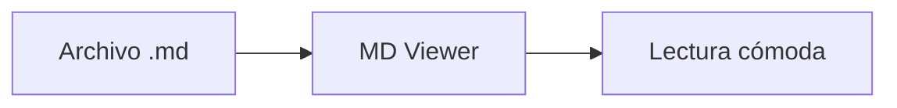

# MD Viewer

Abre un archivo Markdown para leerlo con formato. Nada sale de tu equipo: el archivo se procesa en el navegador.

## Cómo abrir un documento

- Pulsa **Abrir archivo** en la barra superior.
- Pulsa **Abrir carpeta** para navegar por todos sus `.md` y ver sus imágenes.
- Arrastra un archivo o una carpeta a esta ventana.
- Pega texto Markdown con <kbd>Ctrl</kbd> + <kbd>V</kbd>.

## Qué incluye

| Función | Detalle |
|---------|---------|
| Índice | Navegación lateral con la sección activa |
| Código | Resaltado de sintaxis y botón de copiar |
| Fórmulas | KaTeX, por ejemplo $e^{i\pi} + 1 = 0$ |
| Diagramas | Bloques `mermaid` |
| Recarga | La vista se actualiza al guardar el archivo |

